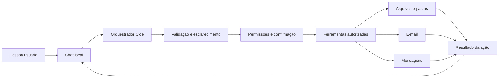

# Cloe Agent

**Protótipo local para avaliar fluxos de tarefas e ferramentas de um assistente pessoal.**

Cloe Agent é o projeto de um assistente conversacional local para organizar tarefas pessoais. O produto final deverá transformar pedidos em ações delimitadas, mostrar o que pretende fazer e explicar o resultado.

A proposta começa com tarefas cotidianas e bem delimitadas: criar pastas, preparar e-mails e mensagens e, depois de integrar um serviço, enviar conteúdo somente após confirmação.

## Estado atual

O código disponível ainda **não é um chatbot** e não integra um modelo de linguagem. Ele oferece uma CLI offline que lê casos JSONL, executa um provedor de eco determinístico e compara trechos esperados na resposta. Há também um exemplo MCP de leitura com dados sintéticos. A interface de conversa, as ações em pastas e as integrações de e-mail/mensagens ainda serão implementadas.

O runner mede correspondência textual simples; isso não avalia qualidade semântica nem segurança de um modelo.

## Executar o protótipo offline

Requer Python 3.11 ou superior.

```bash
python -m venv .venv
# Ative o ambiente virtual e instale o pacote:
python -m pip install -e ".[dev]"
cloe-agent run examples/cases.jsonl --output output/report.json
```

O provedor atual apenas repete o prompt como demonstração. Não há conexão com um modelo, interface de chat ou integração com e-mail.

Execute os testes unitários com `python -m pytest`.

## Como uma tarefa funciona

1. A pessoa descreve o que precisa em linguagem natural.
2. Cloe identifica a intenção e verifica se faltam informações, como destinatário ou caminho.
3. Cloe apresenta a ação planejada e os dados que serão usados.
4. A ferramenta autorizada executa a tarefa, solicitando confirmação antes de envios ou alterações sensíveis.
5. Cloe informa o resultado e eventuais erros.

Por exemplo, para um e-mail, Cloe deve mostrar destinatário, assunto e conteúdo antes de enviar. Uma instrução ambígua deve gerar uma pergunta de esclarecimento, não uma tentativa de adivinhar.

## Escopo planejado

### Organização local

- Criar pastas em locais configurados.
- Listar e localizar pastas dentro das áreas permitidas.
- Organizar arquivos por operações explícitas, com confirmação para ações que possam sobrescrever ou mover conteúdo.

### E-mails e mensagens

- Preparar rascunhos a partir das instruções da conversa.
- Exibir destinatários e conteúdo para revisão.
- Enviar somente depois de uma confirmação clara.
- Informar quando uma integração não estiver configurada ou quando o envio falhar.

### Ferramentas adicionais

A arquitetura deve permitir incluir novas ações sem misturar a interface de conversa com a lógica de cada integração. Calendário, lembretes e outras tarefas poderão ser avaliados depois que o fluxo inicial estiver confiável.

## Documentação

- [Arquitetura e fluxo de envio](docs/arquitetura.md)
- [Plano de implementação](docs/plano-de-implementacao.md)

## Arquitetura proposta



- **Chat:** recebe pedidos e apresenta perguntas, prévias e resultados.
- **Orquestrador:** converte cada pedido em uma sequência pequena de ações.
- **Permissões e confirmação:** limita o que cada ferramenta pode acessar e exige aprovação antes de ações externas ou potencialmente destrutivas.
- **Ferramentas:** implementam operações específicas, como criar uma pasta ou enviar uma mensagem.

## Princípios de segurança e controle

- Ações externas, como enviar e-mails ou mensagens, sempre mostram uma prévia e aguardam confirmação explícita.
- Ações destrutivas ou que sobrescrevam conteúdo também exigem confirmação.
- Cada ferramenta recebe apenas o acesso necessário para sua tarefa.
- Credenciais e tokens não devem ser incluídos no repositório nem exibidos na conversa.
- A pessoa usuária pode entender qual ação será feita e interromper o fluxo antes da execução.

## Escopo inicial

O primeiro recorte deve validar a conversa e a execução de poucas tarefas úteis: criar pastas e preparar mensagens para revisão. O envio real depende de uma integração escolhida e configurada. A interface, o mecanismo conversacional e os serviços de e-mail e mensagens ainda serão definidos no planejamento técnico.

## Estado do projeto

**Protótipo inicial.** A CLI offline e o exemplo MCP são executáveis. O chatbot e as integrações pessoais seguem como trabalho futuro.
