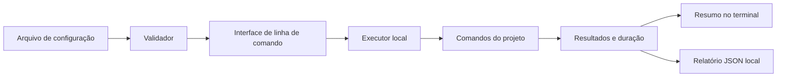

# MX

**Harness local em Python para executar e acompanhar verificações de projetos pessoais.**

O MX reúne tarefas de validação que normalmente são executadas uma por vez — como testes, análise estática e verificações locais — em uma única execução reproduzível. Ele registra o resultado de cada tarefa, mostra um resumo no terminal e salva um relatório para consulta posterior.

O MX é pensado para uso individual na máquina de desenvolvimento. A configuração e os relatórios ficam em arquivos locais; não há serviço remoto para operar.

## O que o MX deverá fazer

- Ler uma configuração com as verificações que compõem uma execução.
- Validar essa configuração antes de iniciar qualquer tarefa.
- Executar comandos locais em sequência, no diretório definido para cada um.
- Aplicar um limite de tempo por tarefa e registrar código de saída, duração e saída do processo.
- Diferenciar verificações aprovadas, reprovadas, interrompidas por tempo e não executadas.
- Exibir um resumo no terminal e gerar um relatório JSON local.
- Encerrar com um código de saída que permita usar o MX em scripts locais.

## Exemplo de uso planejado

Uma configuração poderá agrupar os comandos de validação de um projeto:

```toml
[[checks]]
name = "unit-tests"
command = ["python", "-m", "unittest", "discover"]
working_directory = "."
timeout_seconds = 120
expected_exit_code = 0

[[checks]]
name = "lint"
command = ["ruff", "check", "."]
working_directory = "."
timeout_seconds = 60
expected_exit_code = 0
```

O fluxo de uso pretendido é:

```text
mx.toml → validação da configuração → execução das verificações → resumo + relatório JSON
```

A sintaxe final da configuração e do comando será definida durante a implementação. O exemplo ilustra o formato proposto, não uma funcionalidade já disponível.

## Como será organizado



- **Configuração:** descreve as verificações, seus diretórios, limites de tempo e resultados esperados.
- **Validador:** identifica erros de configuração antes de executar comandos.
- **Executor:** inicia cada comando sem depender de um shell por padrão, aplica limites de tempo e coleta os resultados.
- **Relatório:** apresenta o estado geral e preserva detalhes por verificação em JSON.

## Limites do escopo inicial

- Execução local em uma única máquina.
- Verificações baseadas em comandos de projetos existentes.
- Execução sequencial e relatório local.
- Sem interface web, banco de dados, painel remoto ou execução distribuída.

## Estado do projeto

**Em planejamento.** Este README descreve o comportamento desejado; o MX ainda precisa ser implementado. As decisões de configuração, execução e formato do relatório serão refinadas antes e durante o desenvolvimento.
