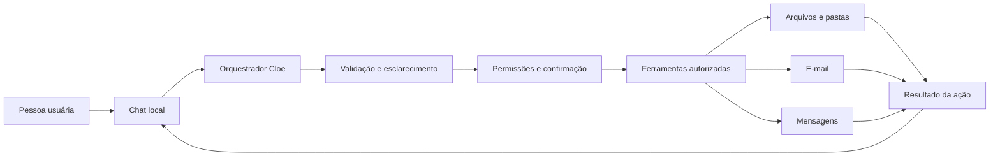
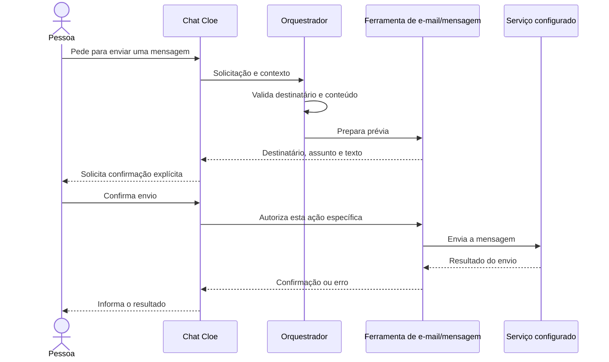

# Arquitetura proposta

## Componentes

- **Chat:** recebe solicitações e exibe perguntas, prévias e resultados.
- **Orquestrador:** transforma cada pedido em uma ação ou sequência curta de ações.
- **Validação:** pede detalhes quando o pedido não informa caminho, destinatário ou conteúdo suficiente.
- **Política de execução:** aplica permissões e exige confirmação antes de enviar, sobrescrever ou remover conteúdo.
- **Ferramentas:** adaptadores independentes para operações locais e serviços externos autorizados.
- **Resultado:** informa sucesso, falha ou ação não executada, sem alegar que algo foi concluído antes da confirmação do serviço.

## Fluxo de envio

