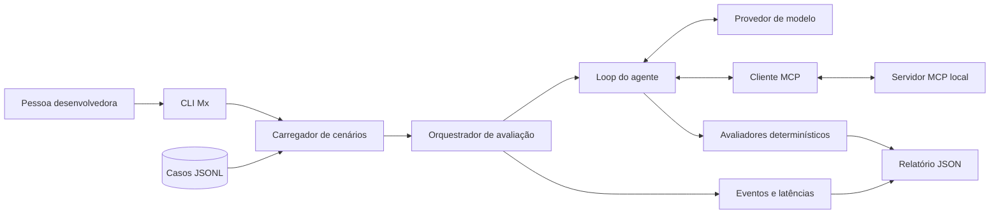

# Arquitetura do Mx

O loop do agente decide quando pedir uma ferramenta. O cliente MCP descobre e chama ferramentas expostas pelos servidores permitidos. O runner registra os passos e envia a resposta e os eventos observados aos avaliadores.

Na versão inicial, o agente e o cliente MCP ainda serão implementados. O servidor de exemplo já existe; o diagrama representa o estado final planejado para o MVP.
